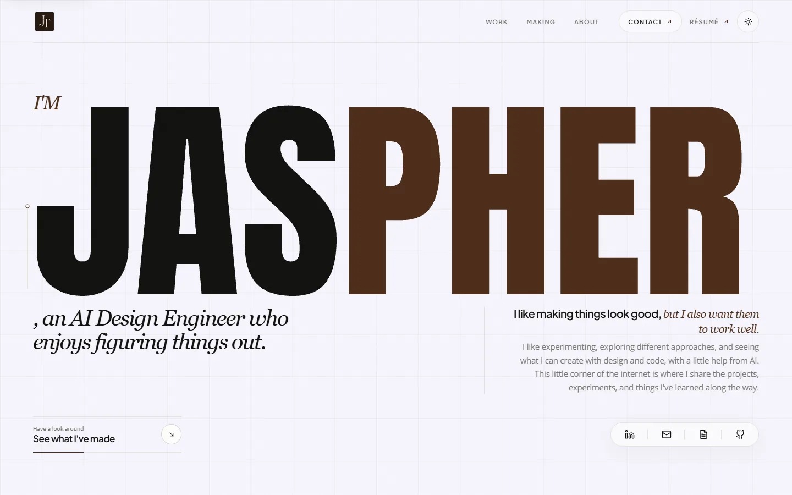

# Jaspher Tania — Portfolio

A personal space for design, front-end work and the experiments in between.

**Live site:** [jtfolio.vercel.app](https://jtfolio.vercel.app)



## About

I'm an AI Design Engineer: I design interfaces and build them with the help of
AI. This site is where I share the projects I've worked on, how I approach
design and code, and a few things I tried along the way.

The site is built the way it describes my process: I start with an idea, work
through the details with ChatGPT, build it with Claude Code, then review and
adjust the result until it feels right.

## What's in it

- **Hero:** the name is drafted as an outlined blueprint, then inked in. A
  loupe follows the pointer to reveal the drawing underneath, and the ink
  drains back as you scroll away.
- **Selected work:** case studies for Clarify, Sakay, HerbaPlant and USE, each
  on its own page covering the problem, the approach, my role and the outcome.
- **Capabilities:** four animated scenes that act out how I work: designing a
  layout, writing the component, exploring and coding with AI, and handing a
  design off to a live site. Each scene loops, pauses when it's off screen and
  can be paused by hand.
- **About:** experience, the tools I reach for, and video edits from my
  freelance work, which play in a dialog.
- **Small details:** light and dark themes, smooth scrolling, a scroll
  progress indicator, and pages that respect reduced-motion settings.

## Built with

| | |
| --- | --- |
| Framework | React 19, TypeScript, React Router 7 |
| Build | Vite 8, with a prerender step that writes static HTML for every route |
| Styling | Tailwind CSS 4 and hand-written CSS per component |
| Motion | Web Animations API and CSS. Smooth scrolling by Lenis |
| Icons | Lucide |
| Images | WebP variants generated at build time with sharp |
| Hosting | Vercel, with Vercel Web Analytics |

## Running it locally

Requires Node.js 20.19+ or 22.12+ and npm.

```bash
npm install
npm run dev        # start the dev server
npm run build      # typecheck, build and prerender into dist/
npm run preview    # serve dist/ with clean URLs and the 404 page
npm run lint       # run ESLint
npm run typecheck  # run the TypeScript compiler
```

`npm run dev` and `npm run build` both generate resized image variants first,
into `public/_img` and `src/generated`. Both folders are git-ignored.

The site URL used in canonical links, Open Graph tags and the sitemap can be
overridden with a `VITE_SITE_URL` environment variable. Without it, the URL
defaults to the live site.

## Project structure

```text
src/
  components/
    layout/      navigation, footer, theme toggle, smooth scroll
    sections/    homepage sections: hero, work, capabilities, about, contact
    services/    the animated capability scenes
    projects/    case study pages and project cards
  data/          site content: projects, case studies, experience, skills
  hooks/         entrance animations, hero effects, scroll timelines
  lib/           scene runtime, SEO tags, theme, site settings
  pages/         route components
  styles/        tokens, base styles, the motion system
public/          images, fonts and the résumé
scripts/         image optimisation and prerendering
```

Notes for working on the codebase (conventions, the motion system, where
content lives) are in [AGENTS.md](AGENTS.md).

## Deployment

The site is deployed on Vercel through its GitHub integration. Commits to
`main` go to production, and other branches get preview deployments.
`vercel.json` runs `npm run build` and serves `dist/` with clean URLs.

## License

This repository doesn't include a license, so the code, writing and images
aren't licensed for reuse. © Jaspher Tania.
